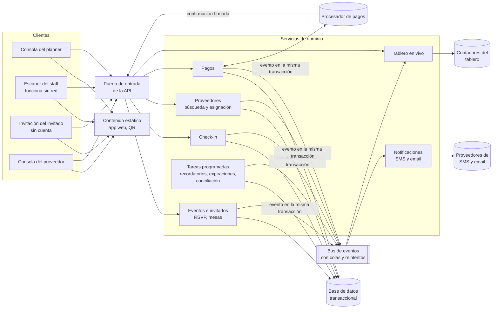
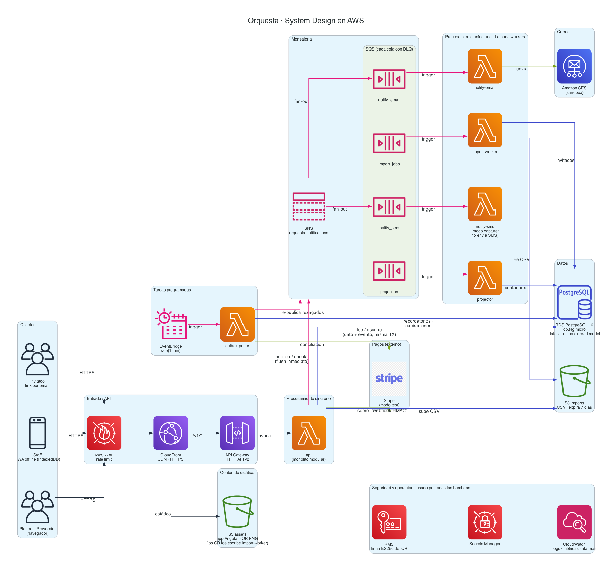

# Orquesta

[](https://github.com/stephy0410/orquesta/actions/workflows/ci.yml)

Plataforma para *wedding & event planners*: invitaciones con QR, RSVP sin cuenta, check-in offline en el venue, tablero en vivo de todos los eventos, contratación y pago de proveedores, y acomodo de mesas.

> **¿Quieres verla funcionando?** [Orquesta en acción](docs/recorrido.md) recorre la aplicación pantalla por pantalla, con capturas de la app corriendo.

Este README sigue el **delivery framework** de system design (Requirements → Core Entities → API → Data Flow → High-Level Design → Deep Dives) y agrega lo que un equipo necesita para operar el sistema: estado de entrega, calidad, CI/CD, cómo correrlo, responsables y riesgos.

> **Fuente de verdad.** La especificación normativa (22 RF, 12 NFR, 20 TR, 29 AC y decisiones D1–D11) vive en [`docs/requerimientos.md`](docs/requerimientos.md). La narrativa de diseño detallada está en [`docs/delivery/`](docs/delivery/README.md). Este README resume y enlaza; si hay contradicción, gana `docs/requerimientos.md`.

## Contenido

0. [Estado de entrega](#0-estado-de-entrega)
1. [Requirements](#1-requirements)
2. [Core Entities](#2-core-entities)
3. [API](#3-api)
4. [Data Flow](#4-data-flow)
5. [High-Level Design](#5-high-level-design)
6. [Deep Dives](#6-deep-dives)
7. [Calidad y trazabilidad](#7-calidad-y-trazabilidad)
8. [CI/CD](#8-cicd)
9. [Cómo correrlo](#9-cómo-correrlo)
10. [Estructura del repositorio](#10-estructura-del-repositorio)
11. [Equipo y responsables](#11-equipo-y-responsables)
12. [Riesgos y trabajo pendiente](#12-riesgos-y-trabajo-pendiente)
13. [Lista de verificación de producción](#13-lista-de-verificación-de-producción)

---

## 0. Estado de entrega

| # | Requisito funcional | Backend | Evidencia (test de aceptación en `back/test/`) |
| --- | --- | --- | --- |
| FR1 | Eventos, importación de invitados, invitación con QR único, RSVP sin cuenta | ✅ | *Ciclo completo del invitado* |
| FR2 | Check-in por QR con mala o nula conectividad | ✅ | *Check-in offline, replay idempotente, convergencia cross-dispositivo…* |
| FR3 | Tablero de todos los eventos casi en tiempo real | ✅ (polling ≤ 5 s p95, ver [ADR-3](#adr-3--tablero-por-polling-con-read-model-en-lugar-de-sse--valkey)) | *Check-in…* (contadores), *Retención…* (agregados) |
| FR4 | Buscar y asignar proveedores, antes y en emergencia | ✅ | *Contratación: 100 solicitudes concurrentes…*, *Bordes normativos…* |
| FR5 | Recordatorios: RSVP a invitados y hora de llegada a proveedores | ✅ | *Ciclo completo del invitado* (RSVP), *Recordatorio de llegada al proveedor* |
| FR6 | Pago a proveedores | ✅ | *Pagos: contract test PSP…*, *Pagos: conciliación automática…*, *Pagos: conciliación diaria…* |
| FR7 | Acomodo de mesas (con control de versión optimista) | ✅ | *Seating: 50 asignaciones concurrentes…*, *Seating: control de versión optimista* |
| FR8 | Invitación por SMS **y** email | ✅ | *Ciclo completo del invitado*, *Bordes normativos…* (`indeterminado`) |

- **16/16 escenarios de aceptación en verde contra los dos backends de datos**: `InMemoryStore` y **PostgreSQL 16 real** (el que usa producción). Antes de esta entrega la suite solo corría en memoria y 7 de 9 escenarios fallaban en PostgreSQL; ver [§7.3](#73-defectos-encontrados-al-correr-contra-postgresql).
- **Pruebas de carga (local, PostgreSQL 16):** check-in a **500/s** durante 60 s en 50 eventos con **0 perdidos, 0 dobles admisiones y p99 de 221 ms** (meta 300 ms); ráfaga offline de 1 000 en 0.5 s. Import de **1 000 invitados en 6.3 s** con latencia de AWS simulada (meta 30 s). Ver [§7.4](#74-pruebas-de-carga).
- **Pruebas de carga en AWS (RDS micro, 2026-11-22):** 500 check-ins/s con **0 dobles admisiones**, p50 93 ms y p99 1.3 s (la CPU de la micro llega a 86 %; meta 300 ms ❌); ráfaga offline en < 30 s; **1 000 invitados en 4.6 s**; búsqueda p95 123 ms; plano de mesas p99 524 ms. Hallaron y corrigieron 4 defectos que en local no aparecían. **Qué se cumple y qué no, requerimiento por requerimiento: [`docs/resultados-aws.md`](docs/resultados-aws.md).**
- **Listo para producción** salvo la decisión del dominio: ver [§13](#13-lista-de-verificación-de-producción).
- **84 endpoints HTTP**, **6 Lambdas**, **7 migraciones versionadas**.
- Frontend Angular (PWA) con las 4 superficies; build y tests corren en CI. Lo pendiente está en [§12](#12-riesgos-y-trabajo-pendiente) y en los [issues del repo](https://github.com/stephy0410/orquesta/issues).

---

## 1. Requirements

### 1.1 Funcionales

1. **FR1** — Las planners crean eventos e importan invitados; cada invitado recibe una invitación con QR único y confirma sin crear cuenta.
2. **FR2** — El staff hace check-in escaneando el QR en el venue, incluso con mala o nula conectividad.
3. **FR3** — Los planners monitorean todos sus eventos en vivo desde un solo tablero, casi en tiempo real.
4. **FR4** — Los planners pueden buscar proveedores y asignarlos al evento antes del evento y por alguna emergencia en el evento.
5. **FR5** — Recordatorios automáticos: RSVP para invitados y hora de llegada para proveedores.
6. **FR6** — El planner puede pagar a los proveedores.
7. **FR7** — Los planners pueden organizar el acomodo de mesas de los invitados.
8. **FR8** — Los invitados reciben su invitación por SMS y email.

**Fuera de alcance:** facturación CFDI, presupuestos, asistente de IA, apps nativas y portal del anfitrión.

La descomposición normativa en RF-01…RF-22 con prioridad MVP está en [`docs/requerimientos.md` §2 y §12](docs/requerimientos.md).

### 1.2 No funcionales

| Área | Objetivo | Cómo se cumple hoy |
| --- | --- | --- |
| **Invitaciones y RSVP** (FR1) | Importar 1 000 invitados < 30 s. QR firmado, no adivinable, sin PII. RSVP con LCP p75 < 2.5 s en 4G. | Import asíncrono por SQS con inserción en lote, firma de QR en paralelo y PNG después del commit: **1 000 en 6.3 s, 20 000 en 125 s** con latencia de AWS simulada ([§7.4](#74-pruebas-de-carga)); en AWS, **1 000 en 4.6 s** y 5 000 en 8.4 s ([resultados](docs/resultados-aws.md)); QR = JWS **ES256** (KMS) con `{invitation_id, event_id, token_version}`; `rsvp_token` ≥ 128 bits, solo se guarda su SHA-256. Shell de RSVP cacheable (token en el *fragment*). |
| **Check-in** (FR2) | Verificar y guardar en el dispositivo en ≤ 100 ms p95 sin red (NFR-04); 500 escrituras/s en ráfagas de 60 s (NFR-01); cero check-ins perdidos; un QR nunca admite más de su cupo; 500 pendientes sincronizan en < 30 s. Meta interna del servidor: p99 < 300 ms por lote. | Verificación de firma **en el dispositivo** (Web Crypto) + cola durable en IndexedDB (RPO 0); lotes ≤ 500 en **una** transacción; idempotencia por `(invitation, device, sequence)`; índice único parcial `(invitation_id, admision_ciclo) WHERE kind='admitido'`. Carga local: 500/s sin pérdidas ni duplicados, p99 221 ms; en AWS con RDS micro: 500/s sin duplicados, p99 1.3 s ([resultados en AWS](docs/resultados-aws.md)). La verificación offline se calcula en < 100 ms en prueba automatizada (`qr-verifier.service.spec.ts`); falta medirla en un teléfono real. |
| **Tablero** (FR3) | Un cambio visible en < 3 s; 10 000 conexiones; reconexión < 5 s. | Read model `event_counters` alimentado por outbox + *flush* inmediato + proyector con ventana de 1 s; el cliente hace polling cada 3 s. Spec vigente: **≤ 5 s p95** (NFR-03). Ver [ADR-3](#adr-3--tablero-por-polling-con-read-model-en-lugar-de-sse--valkey). |
| **Proveedores** (FR4) | Búsqueda p95 < 500 ms; nunca doble reserva solapada; en emergencia la solicitud llega en < 60 s; nunca más proveedores que lugares. | `pg_advisory_xact_lock` por trabajador + suma de plazas solapadas (`tstzrange &&`) en la función `aceptar_worker_reservation`; conflicto determinista que nombra la reserva ganadora; **tope por requerimiento** con lock `(evento, rol)` → `409 REQUERIMIENTO_CUBIERTO` o aceptación parcial; **aviso al proveedor por SMS + email vía outbox** (flush inmediato, segundos; en emergencia «URGENTE» y 15 min para responder). |
| **Recordatorios** (FR5) | A la hora programada ±5 min, en la zona horaria del evento, nunca dos veces. | `reminder_job` con `disparar_en` en UTC (zona IANA por evento), barrido cada minuto; unicidad `(destinatario, plantilla, ventana)`. |
| **Pagos** (FR6) | Nunca cobrar ni enviar dos veces; sin datos de tarjeta; ledger *append-only* con conciliación; si el procesador falla, el pago se reintenta y nunca se pierde. | Llave `pay:{reservation_id}`; ledger de doble entrada con trigger diferido de balance y unicidad `(pago, movimiento, cuenta)`; webhook firmado HMAC; **reintento automático** de pagos `pendiente`/`desconocido` por llave de idempotencia y **conciliación diaria** ledger ↔ procesador (`payment_reconciliation`, alarma ante diferencias). |
| **Mesas** (FR7) | Nadie en dos mesas; ninguna mesa sobre capacidad; edición concurrente rechazada con aviso (versión optimista); guardar < 1 s con 500 invitados / 50 mesas. | Lock por evento + conteo transaccional (AC-14); **`plan_version` + `If-Match`** → `409 SEATING_VERSION_CONFLICT`. |
| **SMS y email** (FR8) | 200 invitaciones encoladas < 1 s y entregadas < 5 min; reintentos + DLQ; nunca duplicado por canal; si falla un canal el otro se entrega; respeta bajas; SPF/DKIM/DMARC. | SNS → dos colas SQS independientes (SMS / email) con DLQ; 3 intentos y luego `rebotado`; `indeterminado` a los 15 min; dedupe por `(destinatario, plantilla, ventana)`; **baja del invitado por canal** desde su invitación (`POST /public/invitations/{token}/unsubscribe`), respetada en envíos, reenvíos y recordatorios; SPF/DKIM/DMARC en Terraform al activar dominio propio (`domain.tf`). |

**Transversales:** disponibilidad 99.9 % (99.95 % check-in vie–dom 17:00–02:00, congelamiento de despliegues en sábado — aplicado en el workflow de deploy); aislamiento de fallas (Notification, tablero o PSP caídos no detienen check-in ni contratación); RPO ≤ 5 min / RTO < 1 h con PITR 7 días; TLS + KMS, aislamiento por membresía, [Aviso de privacidad LFPDPPP](front/src/app/features/privacy/privacy.page.ts) y **borrado de teléfonos de invitados a los 90 días** del evento; crecer 10× sin rediseño; WCAG 2.2 AA; alarmas de p99, 5xx y colas atascadas en < 5 min; UTC + zona IANA por evento, idioma/moneda por organización.

### 1.3 Estimación de capacidad (lo que sí cambia el diseño)

- **Objetivo:** 5 000 planners × 4 eventos/mes × 200 invitados ≈ **4 M invitados/mes**.
- **Pico de check-in:** ~2 000 eventos el sábado en la noche → 400 000 check-ins en 90 min ≈ 75 escrituras/s promedio, ~**400/s** reales en los primeros 30 min. Diseñamos para **500/s**.
- **Reconexión offline:** al volver la señal los escáneres envían todo lo pendiente → ráfagas sobre el pico ⇒ **sincronización por lotes**.
- **RSVP:** ~10 lecturas por escritura, ~40 M lecturas/mes ⇒ **caché de CDN** para el shell y el QR.
- **Almacenamiento:** ~1 KB/invitado ≈ 50 GB/año: **no es el problema**.

**Conclusión:** lo difícil son las ráfagas de escritura del check-in, la idempotencia en check-in y pagos, el *fan-out* del tablero y la concurrencia en reservas y mesas. Las [Deep Dives](#6-deep-dives) atacan exactamente eso.

---

## 2. Core Entities

Cada entidad tiene **un solo módulo dueño**; los demás reciben copias por eventos de outbox o leen proyecciones. Detalle de columnas e invariantes: [`docs/delivery/02-entidades.md`](docs/delivery/02-entidades.md).

| Dominio (servicio lógico) | Entidades |
| --- | --- |
| **Event** | `User`, `EventMembership`, `Venue`, `Event`, `EventRequirement`, `Guest`, `Invitation`, `RsvpResponse`, `ImportJob`, `Table`, `SeatAssignment`, `SeatingPlan` |
| **Checkin** | `EventAccessToken`, `StaffAssignment`, `ScanSession`, `CheckinEvent` (append-only), `DeviceSyncState`, `CheckinBatchAck` |
| **Dispatch** | `WorkerProfile`, `AvailabilityWindow`, `WorkerReservation`, `PlannerAlert` |
| **Notification** | `InvitationDelivery`, `ReminderJob`, `VerificationChallenge` |
| **Payment** | `Payment`, `PaymentEntry` (ledger append-only), `WebhookEvent` |
| **Live** | `event_counters` (read model), `outbox_event`, `projector_applied` |
| Transversal | `AuditEntry` (append-only), `idempotency_record` |

---

## 3. API

REST/JSON sobre API Gateway HTTP API v2, prefijo `/v1`. Contratos completos: [`03a` planner e invitado](docs/delivery/03a-api-planner-invitado.md) y [`03b` trabajador y escaneo](docs/delivery/03b-api-trabajador-scan.md).

| Superficie | Endpoints clave |
| --- | --- |
| Auth | `POST /auth/register · /auth/login · /auth/verify-email · /auth/password-reset · /auth/event-session` |
| Eventos | `POST /events`, `GET /events`, `PATCH /events/{id}`, `POST /events/{id}/publish · start · close · cancel`, `members`, `staff-assignments`, `access-tokens` |
| Invitados e invitaciones | `POST /events/{id}/guests/import`, `GET …/imports/{import_id}`, `GET …/invitations/pending-summary`, `POST …/invitations/send · resend` |
| Invitado (público, sin cuenta) | `GET · POST /public/invitations/{rsvp_token}/rsvp` |
| Tablero | `GET /dashboard?limit≤25&cursor` |
| Mesas | `POST · GET /events/{id}/tables`, `POST /events/{id}/seat-assignments`, `DELETE …/seat-assignments/{guest_id}` (con `If-Match`) |
| Check-in | `POST /scan-sessions`, `GET …/roster · revocations`, `POST …/batches` (≤ 500), `PUT …/sync-state`, `POST /events/{id}/checkins/{id}/annulments` |
| Proveedores | `GET /workers`, `PUT /events/{id}/requirements`, `POST /events/{id}/worker-requests`, `POST …/replacements`, `POST /worker/requests/{id}/accept · reject` |
| Pagos | `POST · GET /reservations/{id}/payments`, `POST /webhooks/psp` |

**Convenciones:** `Idempotency-Key` en todo POST no idempotente (misma clave + mismo cuerpo = misma respuesta; cuerpo distinto = `409 IDEMPOTENCY_CONFLICT`); envelope de error `{error:{code,message,details}}` con catálogo cerrado; paginación por cursor; cookie `httpOnly` en navegador y `Bearer` para la PWA de escaneo; `404` si nunca tuviste relación con el evento, `403` si la tuviste y se revocó.

---

## 4. Data Flow

1. **Invitación (FR1, FR8):** CSV → S3 → `import-worker` (valida aforo atómicamente, deduplica, genera QR) → invitados `pendiente_envío` → el planner confirma el envío → outbox → SNS → colas SMS y email **en paralelo** → `InvitationDelivery` por canal.
2. **RSVP (FR1, FR5):** invitado abre `/invitacion/#t=<token>` (shell cacheado) → `POST …/rsvp` → nueva `RsvpResponse` (la anterior queda *superseded*) → cancela recordatorios RSVP pendientes → si declina, libera su asiento.
3. **Check-in (FR2):** la PWA descarga roster firmado + revocaciones → verifica cada QR **localmente** y escribe en IndexedDB antes de mostrar el veredicto → al haber red, envía lotes ≤ 500 → el servidor deduplica, converge duplicados entre dispositivos y emite el delta al tablero.
4. **Tablero (FR3):** toda escritura que mueve contadores inserta en `outbox_event` en la misma transacción → *flush* inmediato → `projector` agrega por evento en ventanas de 1 s → `event_counters` → `GET /dashboard`.
5. **Contratación y pago (FR4, FR6):** búsqueda → solicitud con `costo_congelado` → el proveedor acepta (lock por trabajador) → recordatorios de llegada T-24 h / T-2 h → el planner paga → PSP con llave de idempotencia → ledger de doble entrada → webhook o barrido de conciliación confirman.

Detalle: [`docs/delivery/04-data-flow.md`](docs/delivery/04-data-flow.md).

---

## 5. High-Level Design

Vista general de **cómo funciona el sistema**, sin atarse a herramientas. Qué tecnología concreta implementa cada caja (y por qué) está en [Deep Dives §6.1](#61-arquitectura-en-aws-qué-se-conecta-con-qué).

### 5.1 Componentes y cómo se comunican



**Idea central:** cada escritura importante guarda el dato **y** el evento que la anuncia en la misma transacción (*outbox*). Todo lo lento o poco confiable (SMS, email, recalcular el tablero) se hace después, de forma asíncrona y con reintentos, así que una falla ahí nunca tumba el check-in ni la contratación.

### 5.2 Responsabilidad de cada componente

| Componente | Responsabilidad | Dónde vive en el código |
| --- | --- | --- |
| Eventos e invitados | Ciclo de vida del evento, import de invitados, invitaciones con QR, RSVP, mesas con versión optimista | `routes/{events,guests,invitations,public-rsvp,seating}.js`, `import-worker` |
| Check-in | Sesiones de escaneo, roster firmado, ingesta de lotes offline, anulaciones | `routes/scan.js` · `front/…/scanner` |
| Proveedores | Perfil, disponibilidad, búsqueda, solicitudes, aceptación sin doble reserva, emergencias | `routes/workers.js` + función SQL `aceptar_worker_reservation` |
| Pagos | Cobro idempotente, ledger de doble entrada, reversos, webhook, conciliación | `routes/payments.js`, `shared/payment-reconciliation.js` |
| Tablero en vivo | Contadores por evento proyectados desde los eventos del bus | `routes/dashboard.js`, `projector` |
| Notificaciones | Envío por canal con dedupe, reintentos y estado por entrega | `notify-sms`, `notify-email` |
| Tareas programadas | Rezagados del outbox, recordatorios, expiraciones, `indeterminado`, retención, conciliación de pagos | `outbox-poller` |

## 6. Deep Dives

### 6.1 Arquitectura en AWS: qué se conecta con qué



Solo aparece lo que está desplegado en la demo (workspace `personal` de Terraform): no se dibujan Aurora, dominio propio (Route 53/ACM) ni envío real de SMS, que existen en el código pero no se usaron. Las flechas negras son peticiones síncronas; las rosas, mensajería (encola/trigger); las azules, lectura/escritura de datos; las verdes, servicios externos. KMS, Secrets Manager y CloudWatch los usan todas las Lambdas, así que se agrupan sin flechas para no saturar el diagrama. Versión vectorial: [`orquesta_system_design.svg`](docs/architecture/orquesta_system_design.svg). El diagrama se genera con código ([`docs/architecture/system_design.py`](docs/architecture/system_design.py), librería [`diagrams`](https://diagrams.mingrammer.com/)):

```bash
pip install diagrams            # requiere Graphviz: brew install graphviz
cd docs/architecture && python system_design.py
```

| Servicio AWS | Para qué se usa | Requisito que atiende |
| --- | --- | --- |
| **CloudFront + S3 (assets)** | Sirve la app Angular, el shell de la invitación y los QR PNG desde caché | FR1 (LCP < 2.5 s), ~40 M lecturas/mes |
| **API Gateway HTTP API v2** | Entrada única al API, CORS, throttling (ráfaga 500, 250 req/s) | Todos |
| **Lambda (6 funciones)** | `api` síncrona + 5 workers asíncronos; escalan por invocación | Todos; aislamiento de fallas |
| **RDS PostgreSQL / Aurora Serverless v2** | Base transaccional única con constraints, triggers y locks. Demo: RDS `db.t4g.micro`; producción: Aurora Serverless v2 con réplica ([ADR-7](#adr-7--base-de-datos-de-la-demo-rds-micro-y-no-aurora-ni-rds-proxy)) | Pagos y reservas CP; check-in sin duplicados |
| **S3 (imports)** | CSV de invitados, privado, expira a 7 días | FR1 |
| **SQS + DLQ** (4 colas) | Desacople y reintentos: import, proyección del tablero, SMS, email | FR1, FR3, FR8 |
| **SNS** | *Fan-out* de cada aviso a las colas de SMS y email en paralelo | FR8 (si falla un canal, el otro sale) |
| **EventBridge** | Dispara el `outbox-poller` cada minuto | FR5 (recordatorios ± 5 min), FR6 (conciliación) |
| **KMS** | Llave asimétrica P-256 que firma los QR; cifrado en reposo | FR1/FR2 (QR no falsificable, verificable offline) |
| **Secrets Manager** | Credenciales de BD, secreto de sesión, secreto del webhook, llave de PII | Seguridad |
| **CloudWatch** | Logs, métricas EMF y alarmas (frescura p95, cola offline > 500, error del PSP, DLQ > 0) | Observabilidad (< 5 min) |
| **SES / SNS SMS** | Entrega de email y SMS. Demo: email real por SES (sandbox); SMS en modo *capture* porque el plan gratuito de AWS no incluye SMS ([ADR-6](#adr-6--la-demo-se-despliega-en-una-cuenta-propia-no-en-learner-lab)) | FR8 |

### 6.2 Decisiones de arquitectura (ADR)

#### ADR-1 · Monolito modular en Lambda en lugar de 6 servicios en ECS Fargate
- **Contexto:** el entorno de entrega es AWS Learner Lab (USD 100, sesiones de 4 h, sin `iam:CreateRole`, `cloudfront:*` ni `ses:*`).
- **Decisión:** una Lambda HTTP + 5 Lambdas de trabajo, compartiendo dominio; los límites de servicio se mantienen como módulos con dueño único.
- **Consecuencias:** costo ~0 en reposo y escalado por invocación; el aislamiento de fallas se logra por **colas independientes** (notificaciones, proyección, import) y por el barrido de conciliación que nunca propaga errores del PSP. Para separar un servicio basta mover su router y sus consumidores: no hay lecturas cruzadas de tablas de otro dominio en las rutas.

#### ADR-2 · PostgreSQL para check-in en lugar de DynamoDB
- **Decisión:** `checkin_event` append-only en PostgreSQL; el lote completo (≤ 500) en una transacción; idempotencia y convergencia por restricciones únicas.
- **Por qué:** una sola base transaccional simplifica la convergencia cross-dispositivo, la anulación auditada y el corte al cierre.
- **Evidencia:** prueba de carga ([§7.4](#74-pruebas-de-carga)): 500 check-ins/s sostenidos 60 s sobre 50 eventos, 0 pérdidas y 0 dobles admisiones, tanto en local como en AWS con `db.t4g.micro` (ahí el p99 sube a 1.3 s porque la micro se satura; [resultados](docs/resultados-aws.md)). La vía de escape es particionar `checkin_event` por evento o mover solo la ingesta a DynamoDB con escrituras condicionales.

#### ADR-3 · Tablero por polling con read model en lugar de SSE + Valkey
- **Decisión:** `event_counters` alimentado por outbox; el cliente consulta cada 3 s con `limit ≤ 25`.
- **Por qué:** ElastiCache/Valkey no está disponible en el entorno y 10 000 conexiones SSE no son viables en Lambda. NFR-03 de la spec vigente fija **≤ 5 s p95**, más laxo que los 3 s del objetivo original.
- **Riesgo:** con muchos planners conectados el polling cuesta lecturas; la evolución natural es API Gateway WebSocket o SSE en un contenedor, alimentado por el mismo outbox.

#### ADR-4 · Zonas + radio en lugar de PostGIS para la búsqueda de proveedores
- **Decisión:** catálogo cerrado de zonas por perfil más `radio_km`, con índice parcial de visibilidad.
- **Por qué:** suficiente para el MVP en una ciudad y sin extensión adicional. El objetivo de 25 km con PostGIS queda como evolución.

#### ADR-5 · Un solo reloj: el de la aplicación
- **Decisión:** toda marca temporal que participa en una regla de negocio (expiraciones, `estado_en`, recordatorios, pagos) la fija la aplicación (`ctx.now()`), no `DEFAULT now()` de la base.
- **Por qué:** evita reglas evaluadas con dos relojes distintos y hace testeable el tiempo (las pruebas viajan meses hacia adelante). Los guardias de inmutabilidad de la BD siguen usando su propio reloj como defensa en profundidad.

#### ADR-6 · La demo se despliega en una cuenta propia, no en Learner Lab
- **Contexto:** Learner Lab bloquea SES (correo), SMS, CloudFront, la creación de roles IAM, las instancias de Aurora y la lectura de *object lock* de S3, que el provider de Terraform (v5 y v6) necesita para administrar buckets. Además, la sesión se apaga a las 4 h y las credenciales cambian.
- **Decisión:** desplegar la demo en una cuenta propia en el plan gratuito de AWS (crédito de USD 157), con el perfil económico de `lab` más CloudFront, WAF y SES. Terraform crea el rol de las Lambdas con permisos mínimos (`use_lab_role=false`, [`iam.tf`](terraform/iam.tf)); Learner Lab sigue soportado con `LabRole`.
- **Consecuencias:** correo real y HTTPS (la cámara del escáner lo exige). El plan gratuito trae sus propios límites: respaldos de RDS de 1 día y sin SMS; los tres se quitan pasando la cuenta al plan de pago. Costo de la demo: unos USD 0.85 al día. SES arranca en *sandbox*: solo envía a correos verificados hasta que AWS aprueba el acceso de producción.

#### ADR-7 · Base de datos de la demo: RDS micro y no Aurora ni RDS Proxy
- **Contexto:** Aurora Serverless v2 cobra un mínimo de 0.5 ACU (≈ USD 43 al mes) aunque no haya tráfico, y RDS Proxy otros ≈ USD 20 al mes; juntos agotarían el crédito de la demo en pocos meses.
- **Decisión:** la demo usa RDS PostgreSQL 16 `db.t4g.micro` (cifrado, en la capa gratuita). La configuración de producción no cambia: Aurora Serverless v2 con réplica y PITR de 7 días (`environment=prod`).
- **Consecuencias:** una sola instancia, sin failover, con unas 90 conexiones. **Se comprobó en AWS (2026-11-22):** con la cuota de 1 000 Lambdas, el API escaló a 641 instancias y la micro respondió `too many clients` (82 % de lotes fallidos). Mitigación aplicada: **tope de 30 instancias para `api` con `DB_POOL_MAX=2`** (`api_reserved_concurrency`, `api_db_pool_max`). Al rebasarlo, API Gateway responde 503 y el cliente reintenta con la misma llave de idempotencia. Así sostiene 500 check-ins/s sin errores de base, pero con p99 de 1.3 s (CPU de la micro al 86 %) ([resultados](docs/resultados-aws.md)). Para escalar sigue faltando **RDS Proxy** ([issue](https://github.com/stephy0410/orquesta/issues/32)).

Diseño completo y costos: [`docs/delivery/05-high-level-design.md`](docs/delivery/05-high-level-design.md) · [`07-system-design-back-front.md`](docs/delivery/07-system-design-back-front.md).

### 6.3 Consistencia por funcionalidad

**La consistencia se elige por funcionalidad, no por sistema.**

| Funcionalidad | Modelo | Mecanismo implementado |
| --- | --- | --- |
| **Pagos** | CP, exactamente una vez. *Un cobro doble es peor que un pago que tarda.* | Llave `pay:{reservation_id}` hacia el PSP; `FOR UPDATE` sobre `payment` antes de asentar; ledger con unicidad `(pago, movimiento, cuenta)` y trigger diferido de balance; webhook idempotente por `event_id`; reintento por llave cada minuto y cuadre diario ledger ↔ procesador. |
| **Asignación de proveedores** (antes y en emergencia) | CP, sin doble reserva. | `pg_advisory_xact_lock(worker)` + suma de plazas aceptadas solapadas con `tstzrange`; la perdedora recibe `409 RESERVATION_OVERLAP` con la ganadora. |
| **Check-in** | AP en el borde con reconciliación. *Una puerta que no abre por falta de señal es peor que un duplicado ocasional.* | Veredicto local en < 100 ms; lote idempotente por `(invitation, device, sequence)`; el segundo dispositivo queda `duplicado_tardio` apuntando al check-in vigente; el servidor decide el veredicto persistido. |
| **Tablero** | Eventual, ≤ 5 s p95. | Outbox en la misma transacción + *flush* inmediato + proyector con *coalescing* de 1 s y dedupe por `outbox_event_id`. |
| **Mesas** | Versión optimista. *Cada quien ve sus cambios al instante; un conflicto se avisa en lugar de sobrescribirse.* | `seating_plan.version` con compare-and-set dentro de la transacción de la mutación; invariantes de capacidad bajo lock por evento. |
| **Notificaciones** | Al menos una vez + deduplicación = exactamente una vez para el invitado. | Unicidad `(destinatario, plantilla, ventana)`; canales en colas separadas; reenvío explícito como nueva ventana `resend_n`. |

Los siete problemas difíciles y qué se rompe si falta cada mecanismo: [`docs/delivery/06-deep-dives.md`](docs/delivery/06-deep-dives.md).

---

## 7. Calidad y trazabilidad

### 7.1 Estrategia de pruebas

| Nivel | Qué cubre | Comando |
| --- | --- | --- |
| Aceptación (memoria) | 14 escenarios end-to-end a través del handler HTTP real y los 5 workers; retroalimentación en ~3 s | `cd back && npm test` |
| Aceptación (PostgreSQL) | **La misma suite** contra PgStore, migraciones 001–005 y un esquema limpio por escenario: valida SQL, triggers, constraints y concurrencia real | `cd back && npm run db:up && npm run test:pg` |
| Frontend | Build de producción + tests unitarios (Vitest) | `cd front && npx ng build && npx ng test --watch=false` |
| Infraestructura | `terraform fmt -check` + `validate` | `cd terraform && terraform validate` |
| Carga (check-in) | AC-01 y AC-04: tasa sostenida, pérdidas, dobles admisiones, ráfaga offline, convergencia del tablero | `cd back && npm run db:up && npm run load:checkin` |

### 7.2 Trazabilidad FR → criterios de aceptación → escenario

| FR | AC de la spec | Escenario |
| --- | --- | --- |
| FR1 | AC-06, AC-12, AC-20, AC-21, AC-23 | Ciclo completo del invitado |
| FR2 | AC-03, AC-05, AC-16, AC-17; AC-01 y AC-04 en la prueba de carga | Check-in offline, replay idempotente, convergencia…; `load/checkin-load.js` (§7.4) |
| FR3 | AC-05, AC-16 (tablero = asistentes reales) | Check-in…; Retención… |
| FR4 | AC-07, AC-22, AC-25, AC-26, AC-27, AC-29 | Contratación…; Auth, OTP…; Bordes normativos… |
| FR5 | AC-12 (RSVP), RF-10 (llegada) | Ciclo completo del invitado; Recordatorio de llegada al proveedor |
| FR6 | AC-08, AC-09, AC-26 + conciliación diaria | Pagos: contract test PSP…; Pagos: conciliación automática…; Pagos: conciliación diaria… |
| FR7 | AC-14 + versión optimista | Seating: 50 asignaciones…; Seating: control de versión optimista |
| FR8 | AC-21, RF-04 (`indeterminado`), RF-20 (bajas) | Ciclo completo del invitado; Bordes normativos… |

### 7.3 Defectos encontrados al correr contra PostgreSQL

Correr la suite contra la base real (antes solo corría en memoria) destapó defectos que habrían fallado en producción:

| Defecto | Impacto | Corrección |
| --- | --- | --- |
| Índice único `payment_entry(pago_id) WHERE movimiento='cobro'` impedía la 2.ª línea del asiento doble | **Ningún pago podía registrarse** | Migración `003`: unicidad `(pago_id, movimiento, cuenta)` |
| Columnas OUT de `aceptar_worker_reservation` ambiguas con las de la tabla | **Ningún proveedor podía aceptar** una solicitud | Migración `002`: `#variable_conflict use_column` |
| 5 pagos concurrentes asentaban el ledger en paralelo | Error 500 / riesgo de doble asiento | Asiento único bajo `FOR UPDATE` (`_postCobroLedger`) |
| En PostgreSQL, la cancelación **del proveedor** no recibía el PSP | Se asentaba el reverso pero **nunca se devolvía el dinero** a la planner | `cancelWorkerReservationByWorker` pasa el PSP y el reloj; prueba de reembolso único en ambos stores |
| Lecturas con otra conexión antes del `COMMIT` (`createWorkerProfile`, import, requerimientos) | Respuestas `null` → 500 | Lectura después del commit |
| `RETURNING DISTINCT` (SQL inválido) en el barrido `indeterminado` | El `outbox-poller` fallaba completo cada minuto | CTE + `GROUP BY` |
| Veredicto de check-in tomado tal cual del cliente | Un cliente podía persistir un veredicto arbitrario | El servidor solo acepta admisiones condicionales conocidas |
| Anulación de check-in sin `AuditEntry` ni lock | Incumplía RF-14; dos anulaciones restaban 2 | Auditoría en la misma tx + `FOR UPDATE` |
| Cierre de evento fallaba si un acceso se emitía en el mismo instante | Evento imposible de cerrar | Migración `004` |
| Errores 500 sin log | Alarma de 5xx sin causa raíz | Log estructurado (sin PII) en `errorResponse` |
| Import con KMS + S3 en serie dentro de la transacción | 1 000 invitados en 65 s; 20 000 superaban el timeout de la Lambda | Inserción en lote, firma en paralelo, PNG post-commit (§7.4) |
| Aforo excedido en el worker hacía ROLLBACK del `fallido` | Job colgado en `en_proceso` | Se confirma `fallido` y se lanza después del commit |
| En PostgreSQL no se avisaba al proveedor de solicitudes | Ninguna solicitud ni emergencia le llegaba | `worker_request_created` por outbox con dirección cifrada |
| Arreglos `text[]` contra columnas `char(26)` | Seq scans en check-in e import | Arreglos `char(26)[]` (§7.4) |
| Nombres de invitado/evento sin escapar en el HTML del correo | Inyección de HTML/enlaces en correos | `escapeHtml` en la plantilla |
| `EMAIL_FROM` no definido en Terraform | SES rechazaría todos los correos en `prod` | `EMAIL_FROM` desde `domain.tf` |

---

### 7.4 Pruebas de carga

#### Check-in

Script: [`back/load/checkin-load.js`](back/load/checkin-load.js) (detalle y cómo correrlo en AWS: [`back/load/README.md`](back/load/README.md)). Perfil *open loop*: 50 eventos × 2 dispositivos enviando lotes cada segundo, 2 % de escaneos repetidos en otra puerta y, a la mitad, un dispositivo que vuelve de estar offline con 1 000 escaneos.

| Métrica (local, 2026-11-18) | Objetivo | Primera medición | Tras optimizar |
| --- | --- | --- | --- |
| Tasa sostenida 60 s | 500 check-ins/s (AC-01) | 500/s | **500/s** · 31 000 escaneos (incluye la ráfaga offline) · 6 002 lotes · 0 errores |
| Check-ins perdidos | 0 | 0 | **0** |
| Invitaciones admitidas 2 veces | 0 | 0 | **0** (verificado también en la BD) |
| Ráfaga offline (1 000 en 2 lotes de 500) | < 30 s (AC-04) | 1.4 s | **0.5 s** |
| Convergencia del tablero tras la carga | ≤ 5 s (NFR-03) | 1.2 s | **1.2 s** |
| Latencia por lote (5 escaneos) | p99 < 300 ms en línea | p50 179 · p95 358 · p99 **481 ms** ❌ | p50 122 · p95 193 · p99 **221 ms** ✅ |

**Qué se optimizó:** el ingest hacía 3 lecturas por escaneo; ahora hace 3 por lote. Y, sobre todo, los arreglos se pasaban como `text[]` contra columnas `char(26)`: PostgreSQL convertía la columna y **no usaba los índices** (seq scan, confirmado con `EXPLAIN`). Con `char(26)[]` usa `uq_checkin_idempotency` y la PK de `invitation`. El veredicto en la puerta, de todos modos, se calcula en el dispositivo (< 100 ms).

**En AWS (RDS `db.t4g.micro`, 2026-11-22):** 500/s sostenido, 0 dobles admisiones, p50 93 · p95 370 · **p99 1.3 s** (con ~13 600 respuestas 429/503 reintentadas por el tope de concurrencia y la CPU de la base al 86 %), ráfaga offline en < 30 s. Detalle, causas y qué falta: [`docs/resultados-aws.md`](docs/resultados-aws.md).

#### Import de invitados

Script: [`back/load/import-load.js`](back/load/import-load.js). Archivos con 2 % de duplicados y 1 % de filas inválidas; se verifica que aceptadas = válidas únicas, que no se envía nada y que reimportar no crea nada. Latencia de AWS simulada: 15 ms por firma en KMS y 30 ms por PUT a S3.

| Filas | Antes | Después | Meta |
| --- | --- | --- | --- |
| 1 000 | 64.9 s ❌ | **6.3 s** ✅ | < 30 s |
| 5 000 | — | 31 s | — |
| 20 000 | ~21 min (supera el timeout) | **125 s** ✅ | < 300 s (timeout de `import-worker`) |

Cambios: inserción en lote (`unnest`), firma de QR en paralelo con concurrencia acotada (cuota de KMS), PNG del QR después del COMMIT y con filtro PNG fijo (2× más rápido, mismo tamaño).

**En AWS (2026-11-22):** 1 000 en **4.6 s** y 5 000 en **8.4 s** hasta `completado` (la Lambda termina los PNG a los 22.8 s y 96 s), con el `import-worker` en 1 769 MB (1 vCPU). Con 512 MB tardaba ~80 ms por invitado. **20 000 no se corrió:** los PNG llevarían la Lambda a ~380 s, arriba del timeout de 300 s; ver [`docs/resultados-aws.md`](docs/resultados-aws.md).

---

## 8. CI/CD

| Workflow | Disparador | Qué hace |
| --- | --- | --- |
| [`ci.yml`](.github/workflows/ci.yml) | Cada PR y push a `main` | 4 jobs en paralelo: backend en memoria (Node 20 = runtime Lambda) + lint; backend contra **PostgreSQL 16** como service container; frontend build + tests (Node 24); Terraform `fmt` + `validate`. |
| [`deploy.yml`](.github/workflows/deploy.yml) | Manual (`workflow_dispatch`) | Reutiliza `ci.yml` como gate → build del front → `npm ci --omit=dev` → `terraform plan` (y `apply` si se marca) con estado remoto en S3 → *smoke test* de `/health`. Bloquea `apply` a `prod` en sábado (congelamiento). |

**Configuración inicial (una vez):**
1. *Settings → Branches → main*: exigir PR y los 4 checks de `CI` en verde.
2. *Settings → Environments*: crear `lab` (y `prod` con revisores obligatorios).
3. En cada environment: secrets `AWS_ACCESS_KEY_ID`, `AWS_SECRET_ACCESS_KEY`, `AWS_SESSION_TOKEN` (en Learner Lab se renuevan cada sesión) y variable `TF_STATE_BUCKET` con un bucket S3 existente para el estado de Terraform.
4. En `prod` (opcional): `ALARM_EMAIL` para recibir las alarmas, y `CUSTOM_DOMAIN` + `ROUTE53_ZONE_ID` para el dominio propio. El workflow aplica el perfil de producción solo: Aurora con réplica en otra zona, CloudFront + WAF, SES, SMS real y firma con KMS.

Las migraciones se aplican solas en el *cold start* (`AUTO_MIGRATE=true`) con advisory lock; son **inmutables**: un cambio de esquema es un archivo `NNN_*.sql` nuevo.

---

## 9. Cómo correrlo

**Requisitos:** Node 20+ (backend), Node 24 (frontend, Angular CLI 22), Docker (PostgreSQL local), Terraform ≥ 1.5.

### Ver la app completa en tu máquina (sin AWS)

```bash
# Terminal 1: backend completo en http://localhost:3000
cd back && npm ci
npm run db:up          # PostgreSQL en Docker (o salta este paso y usa: npm run dev -- --memory)
npm run dev

# Terminal 2: frontend en http://localhost:4200 (requiere Node 24: brew install node@24 o nvm)
cd front && npm ci && npx ng serve
```

Con el backend corriendo, `cd back && npm run seed` llena la app con datos de demostración (planner `demo@orquesta.test` / `Demo12345!`, una boda con mesas y DJ pagado, una gala en curso con check-ins, un proveedor y un link de invitado). Si el puerto 3000 está ocupado: `PORT=3001 npm run dev`, `API_URL=http://localhost:3001 npm run seed` y apunta el front con `window.__ORQUESTA_API__ = { baseUrl: 'http://localhost:3001' }` en `front/public/runtime-config.js` (cambio local, no se sube).

`npm run dev` corre el mismo handler de la Lambda `api` y los workers en proceso (import, tablero, SMS, email, recordatorios y conciliación). **Email y SMS no se envían: se imprimen en la Terminal 1**, con los tokens de verificación, los códigos OTP y los links de invitación para copiarlos al navegador.

Recorrido sugerido: registrarte como planner (pega el token de la consola) → crear y publicar un evento → importar un CSV → enviar invitaciones → abrir un link de invitación de la consola y confirmar → crear un acceso de staff y abrir `/scan` → ver el tablero.

### Comandos por carpeta

```bash
# Backend
cd back
npm ci
npm test               # suite de aceptación en memoria
npm run db:up          # PostgreSQL 16 en localhost:55432
npm run test:pg        # misma suite contra PostgreSQL
npm run db:down

# Frontend
cd front
npm ci
npx ng serve           # http://localhost:4200

# Infraestructura (Learner Lab)
cd terraform
terraform init && terraform plan -out=tfplan && terraform apply tfplan
terraform destroy      # al terminar la sesión, para no consumir crédito

# Infraestructura en cuenta propia (la demo, ADR-6): rol IAM propio, CloudFront, WAF y SES
AWS_PROFILE=<perfil> terraform workspace new personal
AWS_PROFILE=<perfil> terraform apply -var use_lab_role=false -var enable_cloudfront=true \
  -var enable_waf=true -var email_provider_mode=ses -var ses_sender_email=<correo> \
  -var sqs_consumer_max_concurrency=2
```

Variables y modos (`db_mode`, `email_provider_mode`, `enable_cloudfront`…): [`terraform/README.md`](terraform/README.md). Backend: [`back/README.md`](back/README.md). Frontend: [`front/README.md`](front/README.md).

---

## 10. Estructura del repositorio

```text
orquesta/
├── .github/workflows/   # CI (4 jobs) y CD manual a AWS
├── docs/                # requerimientos.md (normativo) + delivery/ (framework 01–07) + architecture/ (diagrama AWS como código)
├── back/                # 6 Lambdas Node.js, dominio compartido, migraciones, suite de aceptación
├── front/               # Angular 22 + PWA: planner, proveedor, invitación, escáner
└── terraform/           # API Gateway, Lambdas, RDS/Aurora, SNS/SQS, S3, KMS, alarmas
```

---

## 11. Equipo y responsables

| Persona | Responsabilidad | Carpeta |
| --- | --- | --- |
| **Hannah** | Frontend: consola del planner, consola del proveedor, invitación pública y PWA de escaneo | `front/` |
| **Stephanie** | Backend: los 6 servicios de dominio, PostgreSQL y migraciones, pruebas de aceptación y de carga | `back/` |
| **Emmanuel** | Infraestructura: AWS / Terraform, despliegue, observabilidad y Learner Lab | `terraform/`, `.github/workflows/deploy.yml` |

Flujo de trabajo: rama por cambio → PR → CI en verde → merge a `main`. El trabajo abierto vive en [GitHub Issues](https://github.com/stephy0410/orquesta/issues).

---

## 12. Riesgos y trabajo pendiente

| Riesgo / pendiente | Impacto | Mitigación / siguiente paso |
| --- | --- | --- |
| Cargas medidas en local (con latencia de AWS simulada en el import) | Falta la cifra en AWS | Correr `checkin-load.js` e `import-load.js` con `--target=http` contra la demo desplegada |
| Conexiones a la base a gran escala (ADR-7) | A 1 000 Lambdas × 5 conexiones se agotan las ~80 de RDS micro (o las de Aurora) | RDS Proxy + `DB_POOL_MAX` 1–2 + concurrencia reservada para `api` |
| Cuenta en plan gratuito (ADR-6) | 10 Lambdas simultáneas, respaldos de 1 día, sin SMS | Aumento de concurrencia solicitado; plan de pago para SMS y PITR de 7 días |
| SES en *sandbox* | Solo llegan correos a direcciones verificadas (máx. 200 al día) | Pedir acceso de producción en SES (≈ 24 h); con dominio propio, DKIM/SPF/DMARC |
| Tablero por polling vs. objetivo original de 3 s / 10 000 conexiones | Puede no cumplir el objetivo original | Medir `lag_frescura` en `lab`; WebSocket si no alcanza (ADR-3) |
| Búsqueda por zonas, no por radio geográfico | No cumple literalmente "25 km" | PostGIS (ADR-4) |
| Learner Lab bloquea SES, SMS, CloudFront, roles IAM, Aurora y el *object lock* de S3 | No se puede desplegar completo ahí (Terraform falla en S3) | La demo vive en una cuenta propia (ADR-6) |
| ¿Dominio propio? (por confirmar con el profesor) | Sin él no hay SPF/DKIM/DMARC ni URL propia con HTTPS | Listo en Terraform: definir `CUSTOM_DOMAIN` y `ROUTE53_ZONE_ID` y desplegar |
| Datos del responsable en el Aviso de privacidad | El aviso necesita razón social, domicilio y correo ARCO reales | Completar `environment.privacy` en el front (revisión legal recomendada) |
| Stripe en modo prueba | Sin cobros reales | Cambiar a llave `sk_live` y registrar el webhook (`STRIPE_WEBHOOK_SECRET`) al salir a producción |

---

## 13. Lista de verificación de producción

Cada requisito transversal del README contra lo que lo cumple. **Lo único pendiente de decidir es el dominio propio**; todo lo demás se activa con el despliegue a `prod`.

| Requisito | Cómo se cumple | Dónde |
| --- | --- | --- |
| TLS en todo el tráfico | CloudFront `redirect-to-https` (TLS 1.2+ con dominio propio); API Gateway solo HTTPS; RDS con TLS | `storage.tf`, `db.js` |
| Cifrado en reposo con KMS | RDS/Aurora `storage_encrypted`; S3 SSE; PII cifrada con AES-256-GCM en la app; QR firmado con KMS | `database.tf`, `storage.tf`, `crypto.js` |
| Cada organización solo ve sus datos | Autorización por membresía en cada endpoint (`404` si nunca hubo relación) | `http.js`, `authorizeEventAccess` |
| QR sin datos personales | JWS con `{invitation_id, event_id, token_version}` | `pg-store-methods.js` |
| Aviso de privacidad LFPDPPP | Página `/privacidad`, enlazada en invitación, registros y correos | `front/…/privacy.page.ts` |
| Teléfonos de invitados se borran a los 90 días | Barrido diario en `outbox-poller` | `sweepGuestPhones` |
| Baja del invitado respetada | Baja por canal sin cuenta; envíos, reenvíos y recordatorios la respetan | `unsubscribeGuest`, migración `007` |
| SPF, DKIM y DMARC | Registros en Route 53 + identidad SES verificada | `domain.tf` (requiere dominio) |
| WAF | Reglas administradas + límite por IP en CloudFront | `waf.tf` |
| Si cae una zona no se pierde nada | Aurora: almacenamiento en 6 copias / 3 AZ + réplica para failover | `database.tf` |
| PITR 7 días, RPO ≤ 5 min, RTO < 1 h | `backup_retention_period = 7` en `prod`; Aurora PITR (la demo en plan gratuito: 1 día, ADR-6) | `database.tf` |
| Alarmas de p99, 5xx y colas atascadas en < 5 min | API 5xx, latencia p99, errores por Lambda, edad del mensaje más viejo por cola, DLQ, frescura, PSP; todas notifican a SNS (+ email) | `observability.tf` |
| Aislamiento de fallas | Colas independientes por canal; PSP y notificaciones nunca bloquean check-in ni contratación | `notify-*`, `payment-reconciliation.js` |
| Pagos reales sin tocar tarjetas | Stripe Checkout hospedado (PCI SAQ A) con el diseño de Orquesta; webhook con firma `Stripe-Signature`; reembolso automático si se cancela una reserva pagada | `StripePspAdapter`, `routes/payments.js` |
| Congelamiento de despliegues en sábado | El workflow rechaza `apply` a `prod` en sábado | `deploy.yml` |
| Accesibilidad WCAG 2.2 AA y LCP < 2.5 s | Auditoría axe + recorrido con teclado; LCP p75 2.35 s | PRs #14 y #15 (front) |

